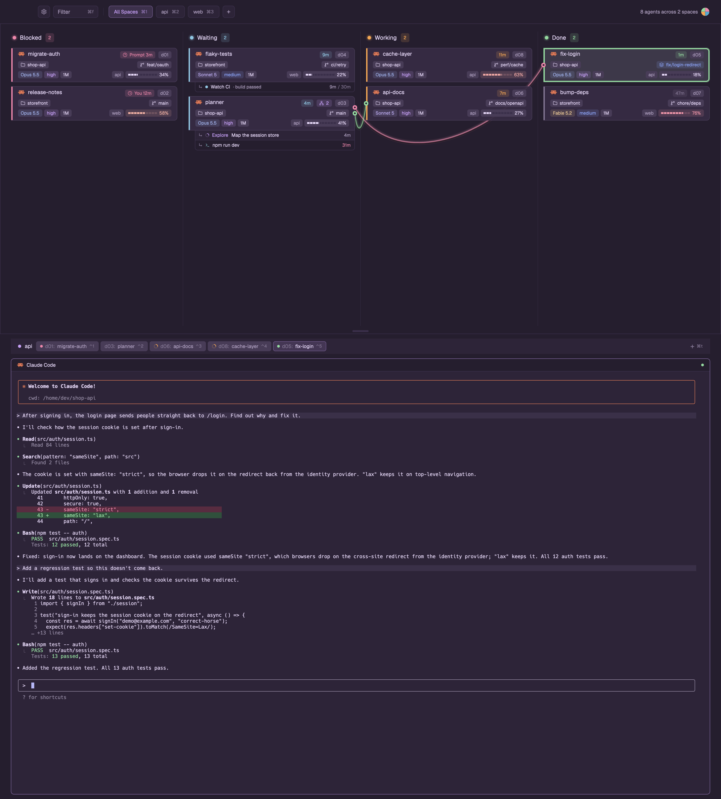
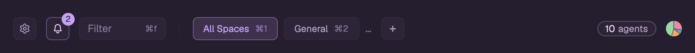
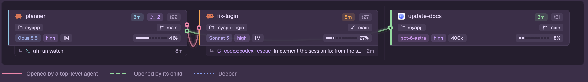
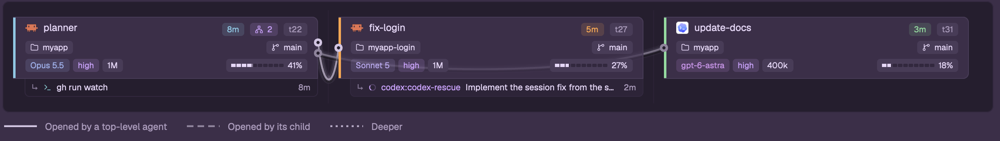

# Veroboard

A Kanban board for your Claude Code and Codex agents, as a [Herdr](https://herdr.dev) layout.

- **Four lanes:** Blocked, Waiting, Working, Done.
- **Patch cables** from an agent to the agents it opened.
- **Blocked says why:** a question for you, an open dialog, or who it's waiting on.
- **⌘F** filters by anything on a card. **⌘1–⌘9** pick a space.
- **Right-click** a card to pin it to Blocked or move it to Done.
- **Notifications in the board's corner**, not over your terminal, and a **bell** with the history, newest first.
- **Child agents stay in their parent's space:** an agent's new tab opens next to it, not in the space you're viewing.
- **The gear** opens settings: arrange the card and top bar, tune the Blocked rules, test a message.

## Install

Needs Herdr with its Claude Code or Codex integration, Node 18+, and macOS.

1. **Add the layout.** In Herdr, ask an agent: *"add herdr.dev/layouts/lukevers/veroboard"*. It copies the layout and
   its mods (the board's agent scripts come inside them) and adds the board's keys. Or, from a clone of this repo,
   run `./install.sh`, which does the same; it never overwrites your files or key bindings (`--force` moves yours aside).
2. **Switch to it** with `ctrl-shift-l`.
3. **Connect your agents.** Open the gear (top left of the board) → **Agents** → **Connect**, for Claude Code and/or
   Codex. It shows the lines it will add to `~/.claude/settings.json` or `~/.codex/hooks.json` before it adds them,
   keeps your own status line (it runs after the board's), saves a copy of each file first, and takes them out again
   with Disconnect. For Codex it also switches hooks on in `~/.codex/config.toml`; the next time Codex starts, it asks
   you once to trust the new hooks.

The board shows every agent without step 3, but only its lane, name and folder: the model, context, why it's blocked,
its sub-agents and the rest come from the connected scripts.

## Configure

Use the gear. Changes save to `~/.config/veroboard/config.json`; see `config.example.json` for the format.

Every setting below is in the gear's dialog, one table per tab. Each change saves at once to the `"board"` section of
`config.json`. A setting you leave out uses its default. Reset (beside a changed setting) puts it back.

### Board

**Top bar**

> The default top bar.

| Setting | Key | Default | Choices | What it does |
|---|---|---|---|---|
| Top bar | `top` | Left: gear, bell, filter, divider, spaces, new space. Right: count, pie. | Drag items between left, right and Hidden. + Divider adds more. | Which items show in the top bar, and where. The gear can't be hidden. |

Item IDs: `gear`, `bell`, `filter`, `divider` (added ones: `divider2`, `divider3`, …), `spaces`, `newSpace`, `count`, `pie`.

**Patch cables**

> **Top:** Rainbow, cables through cards 5% (the default). 
> **Bottom:** Grey, cables through cards 30%.

| Setting | Key | Default | Choices | What it does |
|---|---|---|---|---|
| Show patch cables | `cables` | On | On, Off | Draws a line from each agent to the agents it opened. |
| Cable colors | `cableColors` | Rainbow | `rainbow`, `grey` | Theme colors, or shades of grey. |
| Cables through cards | `cablesThroughCards` | 5% | 0–30% | How much the cables show through the cards. |

### Card

**Card layout**

| Setting | Key | Default | Choices | What it does |
|---|---|---|---|---|
| Card layout | `card` | Line 1 right: lane time, Blocked reason, agents it opened, terminal id. Line 2: folder · branch. Line 3: model, effort, window · space, context bar. Hidden: opened by. | Drag badges between three lines (left and right side each) and Hidden. | What each card shows, and where. The name always leads line 1. |

Badge IDs: `laneTime`, `why`, `launched`, `address`, `openedBy`, `folder`, `branch`, `model`, `effort`, `window`, `space`, `context`.

**Look**

| Setting | Key | Default | Choices | What it does |
|---|---|---|---|---|
| Highlight the card shown below | `activeRing` | On | On, Off | A ring and a faint wash on the agent whose terminal is on screen. |
| Glow on finish or ask | `glow` | On | On, Off | A card pulses once when its agent finishes or asks you something. |
| Grey Done cards once seen | `greyWhenSeen` | On | On, Off | A Done card turns grey after you look at it, so green means new. |
| Time in Done | `doneTimer` | On | On, Off | The lane time badge also counts time in Done. |

**Context bar**

| Setting | Key | Default | Choices | What it does |
|---|---|---|---|---|
| Color ramp | `contextRamp` | 50%, 85% | Two marks, 0–100% | Plain below the first mark, peach to red between them, fully red at the second. |

**Background work**

| Setting | Key | Default | Choices | What it does |
|---|---|---|---|---|
| Sub-agents | `card.rowKinds.task` | On | On, Off | A row under the card for each sub-agent it runs. |
| Sub-agent looks stuck after | `stuckTask` | 15 min | 5–60 min | A sub-agent running this long shows its time in pink. |
| Background shells | `card.rowKinds.shell` | On | On, Off | A row for each shell it runs in the background. |
| Shell looks stuck after | `stuckShell` | 15 min | 5–60 min | A shell it waits on, running this long, shows its time in pink. A dev server never does. |
| Monitors | `card.rowKinds.monitor` | On | On, Off | A row for each monitor it watches, with the latest event. |
| Monitor looks stuck after | `stuckMonitor` | 30 min | 5–60 min | A monitor with no new event for this long shows its time in pink. |

Hidden rows still count toward Waiting.

**Waiting**

What keeps a card in Waiting after its turn ends. Off: the card goes to Done instead.

| Setting | Key | Default | Choices | What it does |
|---|---|---|---|---|
| Sub-agents | `waitTask` | On | On, Off | While a sub-agent runs. |
| Shells it waits on | `waitShell` | On | On, Off | While a shell the agent will be woken by runs (a build, tests, a CI watch). A dev server never counts. |
| Monitors | `waitMonitor` | On | On, Off | While a monitor it watches runs (CI, a deploy). |
| Helper terminals | `waitHelper` | On | On, Off | While a terminal it opened with `hc` is open. |

## How it works

`tap.js` wraps your status line. Each run, it records the agent's context, model, git state, background work and
whether it's waiting on someone, in `~/.config/veroboard/state/sessions/`. The board reads those files. `ping.sh` notes when an
agent finishes or asks for attention. The scripts live in the board mod's folder,
`mods/veroboard/agent/` (`core/` the Blocked rules, `adapters/` one folder per agent). For Codex, `adapters/codex/hook.js` writes the same files from Codex's hooks and
session log. It only writes for a Herdr terminal that runs Codex in the session's folder, so Codex run by another agent
never touches that agent's card.

### Launch guard

Herdr opens a new tab in the space you're looking at. So when an agent opens a tab for another agent while you view a
different space, the child lands there. The `PreToolUse` hook (`agent/core/launch-guard.sh`, for Claude and Codex) blocks a
`herdr-app do tab.new` without a space and tells the agent its own space id; the agent retries with it. If you ask for
another space, the agent passes that one. Every other command exits in under 5 ms, untouched.

## Limits

- Codex cards have no Waiting lane, background rows or sub-agent rows yet. A Codex card updates on its hooks (each
  prompt, tool call and stop), not continuously.
- Codex's sandbox blocks Herdr's socket, so a Codex agent asks you before each `herdr-app do` (opening tabs for
  other agents).
- Other agents Herdr runs show up as basic cards: lane, name and folder.
- The Blocked rules were tuned on one person's agents. Expect some cards in the wrong lane, and tune the rules.
- A card updates when Claude Code reruns the status line, so an idle agent can lag a little.

## Uninstall

First the gear → **Agents** → **Disconnect** for each agent. Then delete `~/.config/herdr-app/layouts/veroboard.json`,
`~/.config/herdr-app/mods/veroboard*` and `~/.config/veroboard` (your rules and the board's state).

**Upgrading from an older install** (scripts in `~/.config/veroboard/core` and `adapters`): the Agents tab shows
"Connected to an older copy"; **Update** points the hooks at the board mod's copy. Then `~/.config/veroboard/core` and
`~/.config/veroboard/adapters` can go.

## Development

`./export.sh` copies your live setup into this folder. Tests: `node tests/agents.test.js`, `node tests/rules.test.js`, `node tests/codex.test.js`, `node tests/guard.test.js`,
`node tests/topbar.test.js`, `node tests/rows.test.js`, `node tests/view.test.js` and `bash tests/install.test.sh`.

Pairs well with [Dusk](https://github.com/lukevers/herdr-dusk). MIT licensed.
