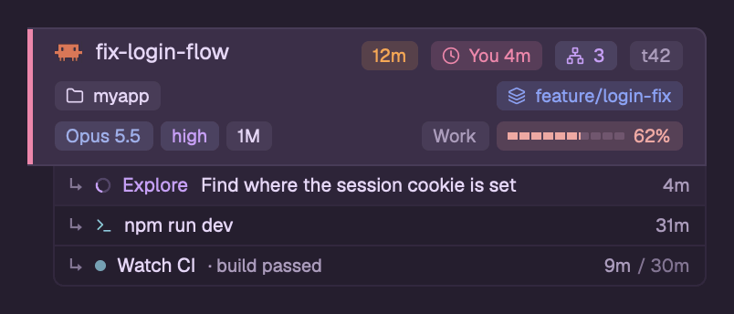
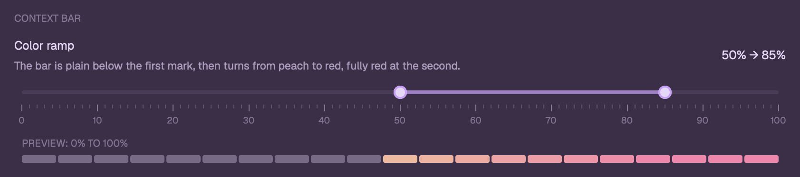
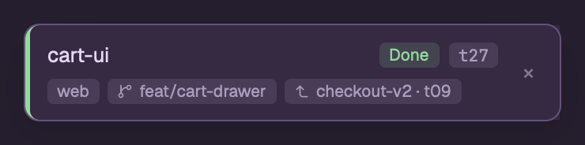
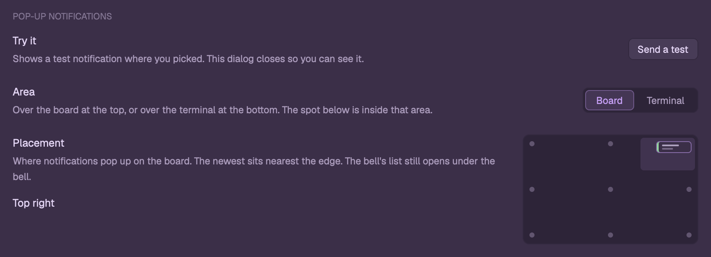
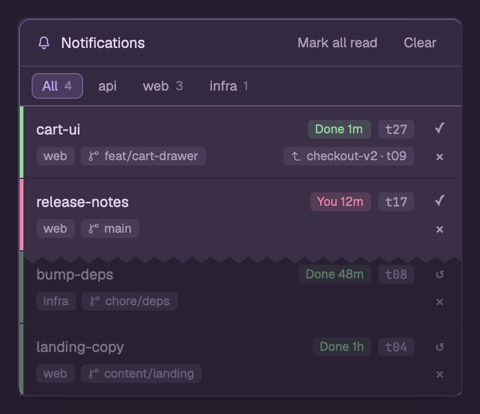

# Veroboard

A Kanban board for your Claude Code and Codex agents, as a [Herdr](https://herdr.dev) layout.

- **Four lanes:** Blocked, Waiting, Working, Done.
- **Patch cables** from an agent to the agents it opened.
- **Blocked says why:** a question for you, an open dialog, or who it's waiting on.
- **⌘F** filters by anything on a card. **⌘1–⌘9** pick a space.
- **Right-click** a card to pin it to Blocked or move it to Done.
- **Notifications in the board's corner**, not over your terminal, and a **bell** with the history, newest first.
- **Child agents stay in their parent's space:** an agent's new tab opens next to it, not in the space you're viewing.
- **The gear** opens settings: arrange the card and top bar, tune the Blocked rules, test a message.

## Install

Needs Herdr with its Claude Code or Codex integration, Node 18+, and macOS.

1. **Add the layout.** In Herdr, ask an agent: *"add herdr.dev/layouts/lukevers/veroboard"*. It copies the layout and
   its mods (the board's agent scripts come inside them) and adds the board's keys. Or, from a clone of this repo,
   run `./install.sh`, which does the same; it never overwrites your files or key bindings (`--force` moves yours aside).
2. **Switch to it** with `ctrl-shift-l`.
3. **Connect your agents.** Open the gear (top left of the board) → **Agents** → **Connect**, for Claude Code and/or
   Codex. It shows the lines it will add to `~/.claude/settings.json` or `~/.codex/hooks.json` before it adds them,
   keeps your own status line (it runs after the board's), saves a copy of each file first, and takes them out again
   with Disconnect. For Codex it also switches hooks on in `~/.codex/config.toml`; the next time Codex starts, it asks
   you once to trust the new hooks.

What Connect adds (Disconnect takes out only these):

| Agent | File | Entry | What it does |
|---|---|---|---|
| Claude Code | `~/.claude/settings.json` | `statusLine` | Runs `tap.js`, which records the agent's facts for its card, then runs your own status line (kept after `--`). |
| | | `subagentStatusLine` | Gives the card its sub-agent rows. If you have your own, it's kept and those rows don't show. |
| | | `PreToolUse` hook (Bash) | The [launch guard](#launch-guard): a tab it opens for another agent lands in its own space, not the one you're viewing. |
| | | `Stop`, `Notification` hooks | Ping the card: its glow, and the Blocked and Done clocks. |
| Codex | `~/.codex/hooks.json` | `SessionStart`, `UserPromptSubmit`, `PostToolUse`, `PermissionRequest`, `Stop`, `Interrupt` hooks | Run `hook.js`, which records the agent's facts for its card. |
| | | `PreToolUse` hook (Bash) | The [launch guard](#launch-guard), as for Claude Code. |
| | `~/.codex/config.toml` | `hooks = true` under `[features]` | Codex runs hooks only with this on. Disconnect leaves it. |

The board shows every agent without step 3, but only its lane, name and folder: the model, context, why it's blocked,
its sub-agents and the rest come from the connected scripts.

## Configure

Use the gear. Changes save to `~/.config/veroboard/config.json`; see `config.example.json` for the format.

Every setting below is in the gear's dialog, one table per tab. Each change saves at once to the `"board"` section of
`config.json`. A setting you leave out uses its default. Reset (beside a changed setting) puts it back.

### Board

**Top bar**

| Setting | Key | Default | Choices | What it does |
|---|---|---|---|---|
| Top bar | `top` | Every item shown, in the places listed below. | Drag items between left, right and Hidden. + Divider adds more. | Which items show in the top bar, and where. The gear can't be hidden. |

The items, in their default order:

| Item | ID | Default place | What it does |
|---|---|---|---|
| Settings | `gear` | Left, 1st | Opens the settings. It can be moved, but not hidden. |
| Notifications | `bell` | Left, 2nd | Lists what Herdr notified you about, newest first. The pill counts the new ones. |
| Filter box | `filter` | Left, 3rd | Filters the board by session name (⌘F). |
| Divider | `divider` | Left, 4th | A short line that sets items apart. + Divider adds more (`divider2`, `divider3`, …). Drag an added one into Hidden to remove it. |
| Spaces | `spaces` | Left, 5th | All Spaces, then a chip for each space. Click a chip to show only that space's agents. |
| New space | `newSpace` | Left, 6th | The + button. It opens a new space. |
| Agent count | `count` | Right, 1st | How many agents are on the board, or how many match the filter. |
| Status pie | `pie` | Right, 2nd | How the agents split between Blocked, Waiting, Working and Done. |

**Patch cables**

> **Top:** Rainbow, cables through cards 5% (the default). 
> **Bottom:** Grey, cables through cards 30%.

| Setting | Key | Default | Choices | What it does |
|---|---|---|---|---|
| Show patch cables | `cables` | On | On, Off | Draws a line from each agent to the agents it opened. |
| Cable colors | `cableColors` | Rainbow | `rainbow`, `grey` | Theme colors, or shades of grey. |
| Cables through cards | `cablesThroughCards` | 5% | 0–30% | How much the cables show through the cards. |

### Card

**Card layout**

> The pink pulse is the **glow**: a card pulses when its agent finishes or asks you something. On the board it pulses once. Turn it off with **Glow on finish or ask**, under Look.
>
> Example "background workers" in the screenshot above, explained: 
> * **Sub-agent** (Explore): an agent this one runs inside its own session. The row shows its type, its task and how long it has run. 
> * **Background shell** (npm run dev): a command it left running, such as a dev server. The row shows how long it has run. 
> * **Monitor** (Watch CI): something it watches until it ends. The row shows the latest event ("build passed"). 9m / 30m means it has watched for 9 minutes, out of 30.

| Setting | Key | Default | Choices | What it does |
|---|---|---|---|---|
| Card layout | `card` | Every badge but Opened by, in the places listed below. | Drag badges between three lines (left and right side each) and Hidden. | What each card shows, and where. |

The badges, in their default order. The name always starts line 1.

| Badge | ID | Default place | What it shows |
|---|---|---|---|
| Time in lane | `laneTime` | Line 1, right, 1st | Working: this turn. Waiting: its oldest background work. Done: how long it has been in Done. |
| Blocked reason | `why` | Line 1, right, 2nd | Why it's in Blocked (You, Prompt, Pinned, or who it waits on) and for how long. Hover it to see the rule. |
| Agents it opened | `launched` | Line 1, right, 3rd | How many agents it opened that still run. |
| Terminal ID | `address` | Line 1, right, 4th | Its Herdr terminal ID (`t21`): what `hc` and other agents call it. |
| Opened by | `openedBy` | Hidden | The terminal ID of the agent that opened it, while that agent runs. Hover it to see that agent's name. Useful with patch cables off. Shown, it goes to line 1, right. |
| Folder | `folder` | Line 2, left | The last folder of where it runs. |
| Branch | `branch` | Line 2, right | Its git branch. Blue with a layers icon in a worktree. A merge or rebase in progress shows next to it. |
| Model | `model` | Line 3, left, 1st | The model, in a color of its own. |
| Effort | `effort` | Line 3, left, 2nd | The reasoning effort. |
| Context window | `window` | Line 3, left, 3rd | The context window's size (200k, 1M). |
| Space | `space` | Line 3, right, 1st | Its Herdr space. Not shown while the board shows one space. |
| Context bar | `context` | Line 3, right, 2nd | How full its context is. The colors follow the context bar's color ramp, below. |

**Look**

| Setting | Key | Default | Choices | What it does |
|---|---|---|---|---|
| Highlight the card shown below | `activeRing` | On | On, Off | A ring and a faint wash on the agent whose terminal is on screen. |
| Glow on finish or ask | `glow` | On | On, Off | A card pulses once when its agent finishes or asks you something. |
| Grey Done cards once seen | `greyWhenSeen` | On | On, Off | A Done card turns grey after you look at it, so green means new. |
| Time in Done | `doneTimer` | On | On, Off | The lane time badge also counts time in Done. |

**Context bar**

| Setting | Key | Default | Choices | What it does |
|---|---|---|---|---|
| Color ramp | `contextRamp` | 50%, 85% | Two marks, 0–100% | Plain below the first mark, peach to red between them, fully red at the second. |

**Background work**

| Setting | Key | Default | Choices | What it does |
|---|---|---|---|---|
| Sub-agents | `card.rowKinds.task` | On | On, Off | A row under the card for each sub-agent it runs. |
| Sub-agent looks stuck after | `stuckTask` | 15 min | 5–60 min | A sub-agent running this long shows its time in pink. |
| Background shells | `card.rowKinds.shell` | On | On, Off | A row for each shell it runs in the background. |
| Shell looks stuck after | `stuckShell` | 15 min | 5–60 min | A shell it waits on, running this long, shows its time in pink. A dev server never does. |
| Monitors | `card.rowKinds.monitor` | On | On, Off | A row for each monitor it watches, with the latest event. |
| Monitor looks stuck after | `stuckMonitor` | 30 min | 5–60 min | A monitor with no new event for this long shows its time in pink. |

Hidden rows still count toward Waiting.

**Waiting**

What keeps a card in Waiting after its turn ends. Off: the card goes to Done instead.

| Setting | Key | Default | Choices | What it does |
|---|---|---|---|---|
| Sub-agents | `waitTask` | On | On, Off | While a sub-agent runs. |
| Shells it waits on | `waitShell` | On | On, Off | While a shell the agent will be woken by runs (a build, tests, a CI watch). A dev server never counts. |
| Monitors | `waitMonitor` | On | On, Off | While a monitor it watches runs (CI, a deploy). |
| Helper terminals | `waitHelper` | On | On, Off | While a terminal it opened with `hc` is open. |

### Notifications

**Pop-up notifications**

Send a test (Try it) shows a test notification where you picked. The dialog closes so you can see it.

| Setting | Key | Default | Choices | What it does |
|---|---|---|---|---|
| Area | `toastArea` | Board | `board`, `terminal` | Where notifications pop up: over the board at the top, or over the terminal at the bottom. |
| Placement | `toastPlace` | Top right | `top-left`, `top-center`, `top-right`, `middle-left`, `middle-center`, `middle-right`, `bottom-left`, `bottom-center`, `bottom-right` | The spot inside that area. The newest notification sits nearest the edge. The bell's list still opens under the bell. |

**Read and unread**

| Setting | Key | Default | Choices | What it does |
|---|---|---|---|---|
| Mark as read | `noticeRead` | On visit | `open` (On open), `visit` (On visit), `hand` (By hand) | When a notification counts as read. On open: opening the bell's list marks all it shows. On visit: clicking it, or going to its agent's terminal any other way (its card, its tab, a key). By hand: clicking it, or its ✓ in the list. |

In every mode, each row in the list has ✓ or ↺ (mark read or unread) and × (remove), and Mark all read works.

### Blocked rules

The People, Asks, Patterns and Rules tabs decide when a card goes to Blocked. They edit the `people` and `blocked`
sections of `config.json`. Every list adds to the package's own (`defaults.json` in `mods/veroboard/agent/core`). Agents
use a change on their next status-line run. The Test tab checks a message against the saved rules.

**People**

| Setting | Key | Default | What it does |
|---|---|---|---|
| People | `people.names` | Empty: any capitalized name counts | If you add names, only these count as people an agent waits on. Agents (`t22`) always count. |
| Not people | `people.notPeople` | CI, Codex, Fable, Opus, Sonnet, Haiku, GitHub, Claude | Tools, bots and models. "Waiting on Sonnet" is background work, not a reason for Blocked. |

**Asks**

Phrases match whole words, in any case.

| Setting | Key | Default | What it does |
|---|---|---|---|
| Asks | `blocked.asks` | Empty | Phrases near the end of a message that mean it waits for you (Blocked · You). |
| Not asks | `blocked.notAsks` | Empty | A sentence with one of these is ignored when looking for an ask. |
| Nothing for you | `blocked.nothingForYou` | Empty | Phrases near the end that say you have nothing to do: never Blocked · You. |
| To-do labels | `blocked.todoLabels` | yours, for you, next for you, on you | Labels that start a line and hand you a to-do ("Still yours: add the key"). |

**Patterns**

JavaScript regular expressions, case-insensitive, for what plain phrases can't say.

| Setting | Key | Default | What it does |
|---|---|---|---|
| Ask patterns | `blocked.patterns.asks` | Empty | A match near the end means an ask (Blocked · You). |
| Not-ask patterns | `blocked.patterns.notAsks` | Empty | A sentence matching one of these is ignored. |

**Rules**

The built-in rules, each with a switch. Switching one off adds its ID to `blocked.disable` (default: empty).

All 29 built-in rules

| ID | Group | What it looks for |
|---|---|---|
| `named-wait` | Waits on someone | Its Next line says it waits for someone |
| `wait-line` | Waits on someone | A line of its own says it waits |
| `next-nothing` | Not blocked | "Next: nothing" means not blocked |
| `nothing-for-you` | Not blocked | It says you have nothing to do |
| `elsewhere` | Ignored sentences | Ignores an ask answered in another agent's tab |
| `outside-if` | Ignored sentences | Ignores an ask that hangs on an outside event |
| `offer` | Ignored sentences | Ignores an optional offer |
| `past-decision` | Ignored sentences | Ignores your earlier decision |
| `question` | Asks you | It ends with a question |
| `negated-ask` | Ignored sentences | Ignores a negated ask |
| `tell-me` | Asks you | "tell me …" |
| `let-me-know` | Asks you | "let me know which / whether / if …" |
| `your-call` | Asks you | "your call / decision / approval …" |
| `needs-you` | Asks you | "needs your …", "needs you to …" |
| `waiting-on-you` | Asks you | "waiting on / for you" |
| `on-hold-until` | Asks you | "on hold until you …" |
| `once-you` | Asks you | "once you decide / confirm / approve …" |
| `on-your-word` | Asks you | "on your go / word / ok" |
| `say-quoted` | Asks you | say / reply / answer, then a quoted word |
| `reply-with` | Asks you | "reply with …" |
| `quoted-when-ready` | Asks you | "'go' when ready" |
| `paste` | Asks you | "paste …" as an instruction |
| `pending-your` | Asks you | "pending your …" |
| `todo-label` | Asks you | A line-start to-do label for you |
| `is-yours` | Asks you | "… is yours" |
| `say-the-word` | Asks you | "say the word / go / yes / which" |
| `do-and-ill` | Asks you | "approve … and I'll …" |
| `pick-one` | Asks you | "pick one", "choose between", "which option" |
| `send-wait` | Waits on someone | After hc send, it says it waits for the answer |

## How it works

`tap.js` wraps your status line. Each run, it records the agent's context, model, git state, background work and
whether it's waiting on someone, in `~/.config/veroboard/state/sessions/`. The board reads those files. `ping.sh` notes when an
agent finishes or asks for attention. The scripts live in the board mod's folder,
`mods/veroboard/agent/` (`core/` the Blocked rules, `adapters/` one folder per agent). For Codex, `adapters/codex/hook.js` writes the same files from Codex's hooks and
session log. It only writes for a Herdr terminal that runs Codex in the session's folder, so Codex run by another agent
never touches that agent's card.

### Launch guard

Herdr opens a new tab in the space you're looking at. So when an agent opens a tab for another agent while you view a
different space, the child lands there. The `PreToolUse` hook (`agent/core/launch-guard.sh`, for Claude and Codex) blocks a
`herdr-app do tab.new` without a space and tells the agent its own space id; the agent retries with it. If you ask for
another space, the agent passes that one. Every other command exits in under 5 ms, untouched.

## Limits

- Codex cards have no Waiting lane, background rows or sub-agent rows yet. A Codex card updates on its hooks (each
  prompt, tool call and stop), not continuously.
- Codex's sandbox blocks Herdr's socket, so a Codex agent asks you before each `herdr-app do` (opening tabs for
  other agents).
- Other agents Herdr runs show up as basic cards: lane, name and folder.
- The Blocked rules were tuned on one person's agents. Expect some cards in the wrong lane, and tune the rules.
- A card updates when Claude Code reruns the status line, so an idle agent can lag a little.

## Uninstall

First the gear → **Agents** → **Disconnect** for each agent. Then delete `~/.config/herdr-app/layouts/veroboard.json`,
`~/.config/herdr-app/mods/veroboard*` and `~/.config/veroboard` (your rules and the board's state).

**Upgrading from an older install** (scripts in `~/.config/veroboard/core` and `adapters`): the Agents tab shows
"Connected to an older copy"; **Update** points the hooks at the board mod's copy. Then `~/.config/veroboard/core` and
`~/.config/veroboard/adapters` can go.

## Development

`./export.sh` copies your live setup into this folder. Tests: `node tests/agents.test.js`, `node tests/rules.test.js`, `node tests/codex.test.js`, `node tests/guard.test.js`,
`node tests/topbar.test.js`, `node tests/rows.test.js`, `node tests/view.test.js` and `bash tests/install.test.sh`.

Pairs well with [Dusk](https://github.com/lukevers/herdr-dusk). MIT licensed.
