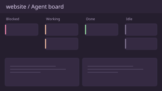

# Veroboard

A Kanban-style board for the [Herdr](https://herdr.dev) app, named after the copper-strip prototyping board: its strips
are the lanes, and patch cables run between them like jumper wires. Every Claude Code agent you run is a card in one of
four lanes: **Blocked** (it needs you, or waits on another agent or a person), **Waiting** (its background work
is still running), **Working**, and **Done**. Patch cables connect an agent to the agents it opened. Badges show how
long each card has been in its lane. A filter box (⌘F) narrows the board by anything on a card (name, model, space, folder, branch,
lane, why it's blocked; several words must all match), and the gear next to it
opens **Board settings**: how the board looks, what puts a card in Blocked, and a box to test a message.



## What you need

- The Herdr app, with its Claude Code integration installed. It sets `HC_TERMINAL_ID` in every terminal and
  installs its own SessionStart hook.
- Node.js 18 or newer.
- macOS. This is the only platform tested so far.

## Install

```sh
./install.sh
```

The script does five things:

1. It copies the Claude Code scripts to `~/.claude/veroboard/`.
2. It creates your rules file, `~/.config/veroboard/config.json`, but only if you don't have one.
3. It copies the board layout, its two mods (`veroboard`, which also draws the settings dialog, and `veroboard-menu`) into
   `~/.config/herdr-app/`.
4. It adds the board's keys to `keys.json`. It never replaces a key you already use, and it backs up the file first.
5. It prints the settings to add to Claude Code. It doesn't edit `~/.claude/settings.json` itself.

The script checks for conflicts before it changes anything. If one of your board files differs from the package,
it stops and lists it. Run `./install.sh --force` to move your version aside as `<name>.bak-<time>` and install.

### Claude Code settings

Add this to `~/.claude/settings.json`. Merge it into your existing `"hooks"` arrays rather than replacing them.

```json
{
  "statusLine": { "type": "command", "command": "node ~/.claude/veroboard/tap.js -- <your status line command, or nothing>", "padding": 0 },
  "subagentStatusLine": { "type": "command", "command": "node ~/.claude/veroboard/subagents.js" },
  "hooks": {
    "Stop": [ { "hooks": [ { "type": "command", "command": "sh ~/.claude/veroboard/ping.sh", "timeout": 5 } ] } ],
    "Notification": [ { "hooks": [ { "type": "command", "command": "sh ~/.claude/veroboard/ping.sh", "timeout": 5 } ] } ]
  }
}
```

Then check the mod and open the layout:

```sh
herdr-app check ~/.config/herdr-app/mods/veroboard
herdr-app do layout.switch --name veroboard     # or ctrl-shift-l to cycle layouts
```

### How `tap.js` works

The board needs facts that only Claude Code's status line receives: context use, the transcript path and the model.
`tap.js` wraps your status line. It writes the board's facts, then runs your own status line with the same input
and prints its output.

- **Put your current command after `--`.** One argument runs through the shell, so pipes work:
  `-- "my-line | tr a b"`. Several arguments run as they are.
- **Nothing after `--`:** it prints nothing and only writes the facts.
- **Writing your own status line in Node?** You can call the facts directly instead:
  `require(process.env.HOME + '/.claude/veroboard/facts.js')(data)`.

`ping.sh` only notes the time. It plays no sound, so add your own after it if you want one, for example
`sh ~/.claude/veroboard/ping.sh; afplay /System/Library/Sounds/Glass.aiff`.

## Display settings

The **Board** tab of Board settings holds the patch-cable settings, with an example of what cables look like; everything about how a card looks is on the **Card**
tab, under the card layout (Look, Context bar, Background work). Colors always come from your Herdr theme, so any
theme works. The screenshots use [Dusk](https://github.com/lukevers/herdr-dusk), a soft purple theme made to go with it. The sliders step from tick to tick in whole units (1% or 1 minute); they never slide between them. Each setting is saved in the `"board"` section of your config; a setting at its default is left out of
the file. The board reloads within a second or two.

| Setting | Default | What it does |
|---|---|---|
| `cables` | `true` | Patch cables from an agent to the agents it opened |
| `cablesThroughCards` | `5` | How much the cables show through the cards, in % (0 to 30) |
| `activeRing` | `true` | A ring and a faint wash on the agent whose terminal is on screen |
| `glow` | `true` | A card pulses once when its agent finishes or asks you something |
| `greyWhenSeen` | `true` | A Done card turns grey once you've looked at it, so green means new |
| `doneTimer` | `true` | A badge with how long a card has been in Done |
| `contextRamp` | `[50, 85]` | The context bar is plain below the first %, then goes peach to red, fully red at the second |
| `stuckMinutes` | `15` | Background work with no news for this long shows its time in pink |

## Right-click a card

- **Pin to Blocked** keeps a card in Blocked until you send that agent a prompt; **Unpin** takes it out.
- **Move to Done** (on a card in Blocked) is for an ask that no longer matters, without telling the agent. The card
  goes to Done (or Waiting, while background work runs) and stays there until something new happens: you prompt it,
  its next message asks again, or a new dialog opens in its tab.
- **Open** shows its terminal.

## The top bar

The **Board** tab starts with the bar at the top of the board, drawn by the board's own code. Drag an item to another
place on it, or into the **Hidden** tray below it to take it off; drag it back out of Hidden to show it again. A drop on
the bar's empty space adds the item to the end of the side you drop it on. You can also click an item and move it with
the arrow keys. The items: **Spaces** (All Spaces and a chip per space), **New
space** (+), **Agent count**, **Status pie**, **Divider**, **Settings** (the gear) and **Filter box**. By default the gear,
filter box and divider come first, then the spaces and +; the count and pie sit on the right. The gear can
be moved but not hidden: it's the way back into these settings. The layout is saved as `board.top` in your config.

## What's on a card

The **Card** tab of Board settings shows an example card with every badge and every kind of background row, drawn by
the board's own card code. **Drag** a badge on it to another place: before or after another badge, or onto a line's
empty side (each side of each line shows an outline while you drag). Drag it into the **Hidden** tray below the card to
take it off, and back out to show it again. You can also click a badge and move it with the arrow keys: ← → along its
line and across to the other side, ↑ ↓ to another line.

The name always starts the first line. The left side of a line shrinks first when a card is narrow; the right side
keeps its width. Below the layout are the card's look settings (highlight, glow, grey once seen, time in Done), the context bar's color
ramp, and the background work settings: **Show background work rows** turns the rows under a card (sub-agents, shells,
monitors) on or off, and **Looks stuck after** sets when their time turns pink. The layout is saved as `board.card`
in your config, and **Reset the card's layout to the default** removes it.

| Badge id | What it shows |
|---|---|
| `laneTime` | Working: this turn. Waiting: its oldest background work. Done: time in Done |
| `why` | Why it's in Blocked (You, Prompt, Pinned, or who it waits on), and for how long |
| `launched` | How many agents it opened that are still running |
| `address` | Its Herdr terminal id |
| `openedBy` | The terminal id of the agent that opened it, while that agent runs; hover for its name. **Hidden by default**: handy with patch cables off |
| `folder` | The last folder of where it runs |
| `branch` | Its git branch (blue in a worktree; a merge or rebase in progress next to it) |
| `model`, `effort`, `window` | The Claude model, reasoning effort and context window size |
| `space` | Its Herdr space (not shown while the board shows one space) |
| `context` | How full its context is |

## Configure the Blocked rules

The easiest way is the **gear** in the board header. It opens **Board settings**:

- **Tabs:** Board, Card, People, Asks, Rules, Patterns and Test: how the board looks, then what puts a card in Blocked
  (simple to advanced), then a box to try it.
- **Lists** (People, Asks, Patterns): default entries show in grey; yours show with a × to remove them. Type in a box and
  press Enter to add one. Each list has an example of what it changes.
- **Rules:** every built-in rule, grouped and in the order they're checked. Click one for what it looks for, an example
  message and the lane that example gives; **Try it in Test** loads the example. The switch turns a rule off or on.
- **Test:** paste an agent's last message to see which lane its card would go to, and which rule decided it.

Each change is saved at once to `~/.config/veroboard/config.json`. Hover a Blocked badge on a card to see the rule
that put it there.

Herdr runs programs without your shell's PATH, so the dialog can't simply call `node` when Node comes from nvm or mise.
`facts.js` records the path of the Node that runs it in `~/.claude/herdr/node-path`, and the mods use that. Until an
agent has run once after install, the dialog can't load.

You can also edit the file by hand (the dialog's **Open file** button opens it).

A card goes to **Blocked · You** when the agent's last message asks you something. It goes to
**Blocked · Luke** or **Blocked · t22** when the agent says it waits on someone else. You tune this in
`~/.config/veroboard/config.json`. Its lists are **added** to the package defaults (`~/.claude/veroboard/defaults.json`).
Changes apply on each agent's next status-line run.

| Field | What it does |
|---|---|
| `people.names` | If set, only these people count as someone an agent waits on. Empty means any capitalized name does. Agents (t22) always count. |
| `people.notPeople` | Tools, bots and models. "Waiting on Sonnet" is background work, not a person. |
| `blocked.asks` | Phrases near the end of a message that mean it waits for you |
| `blocked.notAsks` | Phrases that make a sentence not an ask |
| `blocked.nothingForYou` | Phrases that say you have nothing to do |
| `blocked.todoLabels` | Line-start labels that hand you a to-do ("Action item: …") |
| `blocked.patterns.asks` / `.notAsks` | JavaScript regular expressions (case-insensitive), for advanced users |
| `blocked.disable` | Built-in rule ids to switch off |

Built-in rule ids, in the order they're checked:

- `named-wait`: its own Next line says it waits for someone ("Next: wait for Luke's replies").
- `wait-line`: a line of its own says so ("**Waiting on t22.**").
- `next-nothing`, `nothing-for-you`: it says you have nothing to do, so the card is not blocked.
- `elsewhere`, `outside-if`, `offer`, `past-decision`: these sentences are ignored. They cover an ask answered in
  another agent's tab, a condition on an outside event, an optional offer, and a decision you already made.
- `question`: a "?" at or near the end.
- `negated-ask`: "nothing needs your call" is removed before the phrases below are checked.
- `tell-me`, `let-me-know`, `your-call`, `needs-you`, `waiting-on-you`, `on-hold-until`, `once-you`, `on-your-word`,
  `say-quoted`, `reply-with`, `quoted-when-ready`, `paste`, `pending-your`, `todo-label`, `is-yours`,
  `say-the-word`, `do-and-ill`, `pick-one`: ask phrases.
- `send-wait`: after `hc send tNN`, the message opens by saying it waits for the answer.

Each card's facts file records the rule that decided it, as `awaiting.rule`.

## What the board reads

| File | Written by |
|---|---|
| `~/.claude/herdr/sessions/<terminal>.json` | `tap.js` (`facts.js`): context, model, git, background shells and monitors, launched agents, last prompt, `awaiting` |
| `~/.claude/herdr/subagents/<terminal>.json` | `subagents.js`: running sub-agents |
| `~/.claude/herdr/pings/<terminal>.json` | `ping.sh`: when the agent last finished or asked for attention |
| `~/.claude/herdr/node-path` | `facts.js`: the Node that runs it, for the mods' `exec` calls |

## Known limits

- The Blocked rules were tuned on one person's agents and the way they phrase things. Your agents may phrase
  things differently, so expect some cards in the wrong lane. Use the config to tune them.
- A card's facts update only when Claude Code reruns the status line, which happens on activity. An idle agent's
  card can be a little behind.
- A very large transcript (tens of MB) takes about half a second per status-line run. The status line output itself
  isn't delayed by more than that.

## Tests

`node ~/.claude/veroboard/classify.js "<a message>"` shows where a card with that last message would go.

```sh
node tests/rules.test.js      # the rules and every config field
bash tests/install.test.sh    # install.sh in a throwaway HOME
```

## Uninstall

1. Delete `~/.claude/veroboard/`, `~/.config/veroboard/`, `~/.config/herdr-app/layouts/veroboard.json`,
   `~/.config/herdr-app/mods/veroboard/`, and `~/.config/herdr-app/mods/veroboard-menu/`.
2. Remove the `statusLine` wrapper, `subagentStatusLine` and the two `ping.sh` hooks from `~/.claude/settings.json`.
3. Optionally remove the `"layout:veroboard"` section from `~/.config/herdr-app/keys.json`.

## For the maintainer

`./export.sh` copies the live setup on your machine (`~/.claude/veroboard/` and `~/.config/herdr-app/`) into
this folder.

## License

MIT. See [LICENSE](LICENSE).
