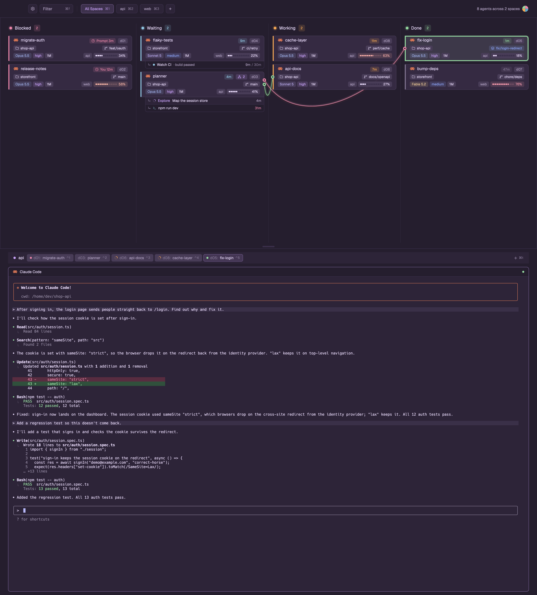

# Veroboard

Every Claude Code agent you run is a card in one of four lanes: Blocked, Waiting, Working and Done. Patch cables run
from an agent to the agents it opened. The board sits above the active tab's terminals, so a click on a card shows that
agent below.

This file is the brief: enough to build Veroboard from an empty folder. The files next to it are one build of it.
If they don't work on your Herdr, or you want it different, build it again from here.

## What you see

Top to bottom:

1. **Header, 52px** (chrome color). Left: a gear button, a 100px filter box ("Filter", ⌘F hint), a 1px divider, then
   space chips: "All Spaces ⌘1" and one per space (⌘2–⌘9), and a "+" for a new space. Right: "N agents across M spaces"
   and a small pie of agent statuses. The order of these items is configurable.
2. **Board, 355px** (canvas color, resizable; a grip below it). Four equal lanes, 24px side padding, 1px divider lines
   (halfway between canvas and border). Each lane has a 27px header: a status dot that breathes while the lane has live
   agents, the label (13px, semibold) and a count pill. Lane colors come from the theme: Blocked `blocked`, Working
   `working`, Done `done`; Waiting is a fixed light blue (#91c7e3).
3. **Cards, 76px**, 3 lines, a 3px status stripe on the left, rounded right corners.
   - Line 1: program icon, tab name; right side: time in lane, why it's blocked, how many agents it opened, terminal id.
   - Line 2: folder; right: git branch (blue in a worktree).
   - Line 3: model, effort, context window; right: space, and a context bar of ten 10% segments (plain below 50%, peach
     to red from 50% to 85%).
   - Under a card, one 22px row per sub-agent, background shell or monitor, with its age (pink when it looks stuck).
4. **Patch cables**: a curved line from an agent's card to each agent it opened, with jack plugs at both ends, one color
   per family. A cable to a card in the same lane loops out and back. Cables pass behind cards, 5% visible through them.
5. **Tab strip, 34px**: the active space's name, its tabs as pills (status spinner or dot, terminal id, name, ⌘ hint),
   and "+ ⌘T".
6. **Terminals**: the active tab's panes, 12px apart, 7px radius, 1px border, each with a 28px header (program icon,
   name, status dot).

## How it behaves

- **Lanes.** Pinned by hand → Blocked. A dialog open in its tab → Blocked ("Prompt"). Herdr says working → Working.
  Idle with background work (sub-agents, monitors, shells that wait, helper terminals) → Waiting. Idle and its last
  message asks you something or says it waits on someone → Blocked ("You", or the name). Otherwise → Done.
- **Blocked reasons** are decided by a rule set in `~/.claude/veroboard/rules.js`; hovering the badge names the rule.
- **Done** cards are green until you've looked at them, then grey. A card glows once when its agent finishes or asks.
- The card whose terminal is on screen gets a 2px ring and a faint wash.
- **Click** a card: focus that agent's terminal. **Right-click**: a menu with Pin to Blocked / Unpin, Move to Done (in
  Blocked) and Open.
- **Wheel** over a lane scrolls it; cables follow. Double-click the grip: reset the board's height.
- **Keys** (keys.json section `layout:veroboard`): ⌘F focuses the filter (every word must match something on a card;
  Esc clears), ⌘1 shows all spaces, ⌘2–⌘9 pick a space.
- **The gear** opens a settings dialog: drag the top bar's items and the card's badges into place or into Hidden;
  switches and sliders for cables, glow, the context color ramp and more; lists that tune the Blocked rules, with
  examples; every built-in rule with an on/off switch; and a box to test a message.
- Tabs are named after what's in them (Claude Code's title, the running program, or the folder) until you rename one.

## Built from

- **Layout** `layouts/veroboard.json`: a column with `board-header` (mod `veroboard`, role `header`), then `board-body`:
  `board-cards` (mod `veroboard`, no role) above `workspace` (`workspace-title`: mod `veroboard`, role `terminals`;
  `live-terminals`: the active tab's panes, pane header mod `veroboard`, role `pane`). Font Geist, no titlebar.
- **Mod `veroboard`**: `main.js` (every role, data loading, lanes, cables), `card.js` (one card from a model, its badge
  layout), `topbar.js` (header items), `cables.js` (cable drawing), `settings.js` (the dialog: opened with
  `mod.open veroboard`, shown when there's an `overlay` prop and no role), `names.js` (tab names).
- **Mod `veroboard-menu`**: the right-click popup.
- **Shipped mods used:** `menu` (tab right-click), `new-menu` (the + button). Icons from `workspace-chrome` and `icons/`.
- **Herdr:** `agents`, `spaces`, `panes`, `terminals`, `shared`/`setShared` (keys `veroboard.*`), `keys`, `nextCommand`,
  `openOverlay`, `setAgentOrder`, `readTextFile`, `writeTextFile`, `watchFolder`, `exec`; commands `agent.focus`,
  `tab.select`, `tab.rename`, `space.new`, `space.select`, `layout.resize`, `mod.open`.
- **Claude Code side** (`claude/` in this repo, installed to `~/.claude/veroboard/`): `tap.js` wraps the status line and
  writes each agent's facts to `~/.config/veroboard/state/sessions/<terminal>.json`; `subagents.js` (the sub-agent status line)
  writes `subagents/`; `ping.sh` (Stop and Notification hooks) writes `pings/`; `rules.js` + `defaults.json` are the
  Blocked rules; `classify.js` tests a message.
- **Programs and files outside the mod folder:** runs `node` (`classify.js`, for the dialog and the rules' hover text);
  reads `~/.config/veroboard/state/`, `~/.claude/veroboard/defaults.json` and `~/.config/veroboard/config.json`; the dialog writes
  that config file.

## Watch out

- **The board needs the Claude Code side.** Copying the layout and mods alone gives cards with no model, context or
  Blocked reasons. Run `./install.sh` from the repo root and add its `~/.claude/settings.json` lines (see the README).
- Herdr runs programs without the shell's PATH. `facts.js` saves the path of the Node it runs under to
  `~/.config/veroboard/state/node-path`, and the mods use it. Until an agent has run once after install, the dialog can't load.
- Mods can't import from another mod's folder, so the settings dialog lives inside `mods/veroboard`.
- `herdr-app check` doesn't build the dialog. Open it to test it.
- Card and cable positions are computed from the layout's numbers (lane padding, 27px header, 76px cards, 22px rows,
  9px gaps). Change one, and update the cable math in `main.js`.
- Sizes from `on_size_change` are real pixels; divide by the zoom setting.
- Elements are single-use: build a badge once even if you test it and place it.
- A slider moves in whole steps on its own. Don't call `set_value` from its change handler; it fights the drag.
- Drag and drop in the dialog is built from mouse down, move, hover and up events.
- Limits: 8 shells and 8 monitors per card, 200 opened agents per agent; sub-agent rows drop after 30s without news.
- Every color is a theme color except Waiting's light blue and the marigold for "waits on someone" (#f2bc78).
- If `veroboard` is taken, rename the layout, both mods, the `layout:veroboard` keys section and the `veroboard.*`
  shared keys before installing.

## Done when

- Every Claude Code agent shows up in the right lane, and each lane's count matches.
- A card shows model, effort, context and branch within one status line run of the agent starting.
- Clicking a card shows its tab's terminals; an agent that asks you something lands in Blocked with a reason.
- An agent that opens another gets a cable to it.
- `herdr-app check mods/veroboard` passes, the gear opens Veroboard settings, and switching layouts away and back works.
